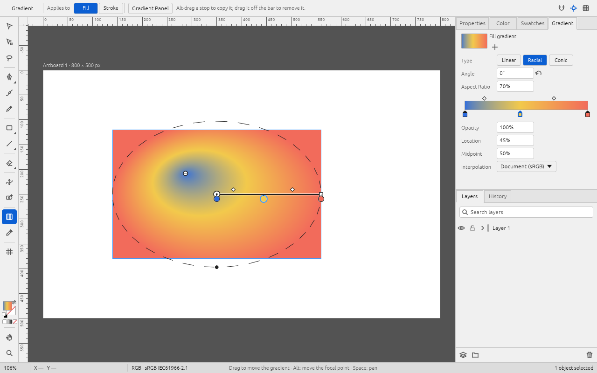
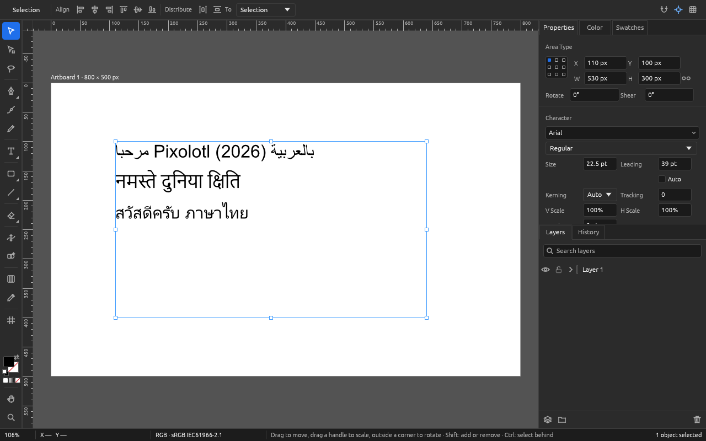
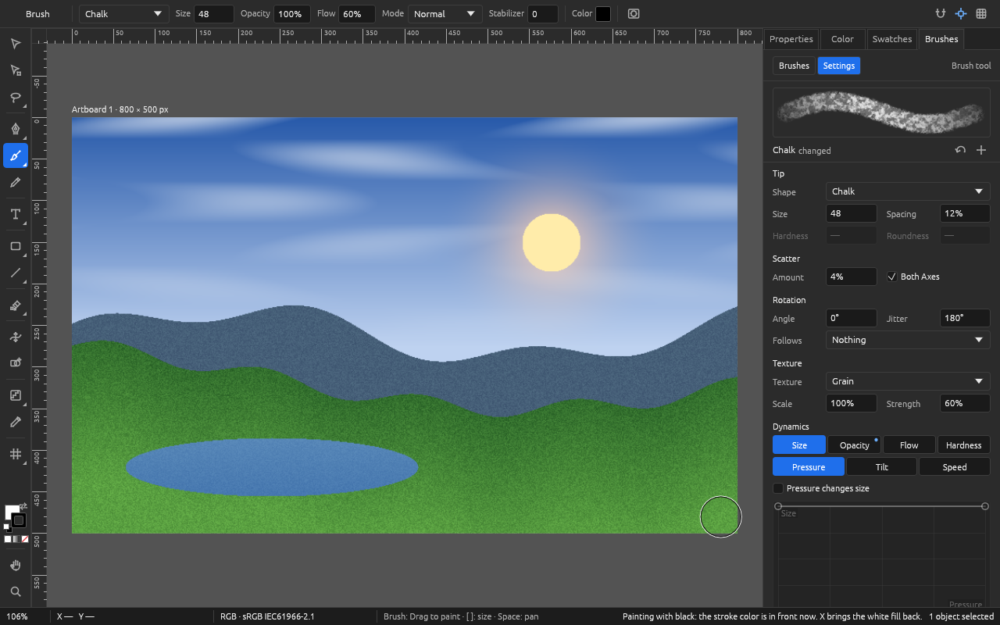
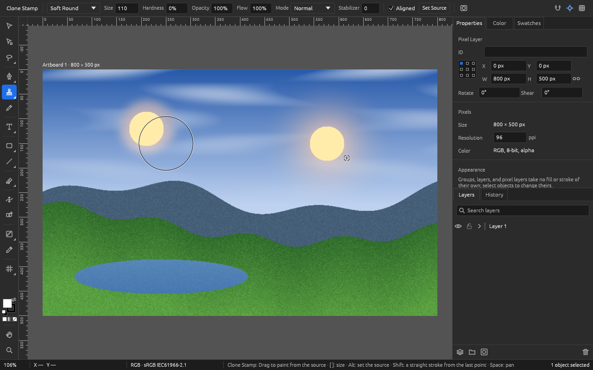

# Pixolotl

### Vector and raster design in one application

Drawing, type, colour for print, and pixels in the same document, so you do not need one program for
vectors and another for images. Free, with **no account, no telemetry and no AI**. 
Made by [CodeMushroom](https://github.com/CodeMushroom).

### [⬇ Download Pixolotl](https://github.com/CodeMushroom/Pixolotl/releases/latest)

> **This is an early test build.** Much of Pixolotl works today and some of it is not built yet (see
> [What is coming](#what-is-coming)). Keep copies of anything important, and please
> [report](#feedback) what goes wrong.

## What it does today

### Draw with precision

Shapes that stay editable, the Pen, Pencil, Paintbrush and Width tools, Shape Builder, Pathfinder and live
boolean shapes, Offset Path, Outline Stroke and Simplify. Several artboards, rulers, guides, grids, smart
guides and snapping. Every field takes typed numbers, units and arithmetic, and nothing drifts when you
save and open again.

### Colour for screen and print

RGB, CMYK, grayscale, Lab and spot colours with ICC colour management. CMYK documents with soft proofing,
gamut warning and overprint preview. Swatches, linear, radial and conic gradients edited on the canvas,
patterns, blend modes, and opacity and clipping masks.

### Type

Point type, area type in any shape and type on a path, with character and paragraph controls, tabs,
OpenType features, variable fonts and styles. Arabic, Hebrew, Devanagari, Thai, Chinese, Japanese and
Korean are shaped and laid out properly, and colour fonts work.

### Pixels in the same document

Pixel layers sit next to vector layers. Select with marquees, lassos, the magic wand or colour range, refine
with feather, grow, shrink and quick mask, and paint on layers and masks with the Brush, Eraser, Smudge,
Clone Stamp, Paint Bucket and Gradient. The Brushes panel has pressure and tilt dynamics and a stabilizer.

### Open and export the files you use

Opens SVG, PDF, Illustrator files saved with PDF content, PNG, JPEG, TIFF, WebP, and ASE, ACO and GPL
swatches. Exports SVG, PDF for print (CMYK, spot colours, bleed, crop marks and a preflight check), PNG,
JPEG, TIFF and WebP with a live preview and the exact file size. Every import tells you anything it could
not bring in. `pixolotl --export` converts files from the command line.

### Never lose work

Unlimited undo with a History panel, safe saving, and automatic recovery of unsaved work after a crash.
Dark and light themes, and interface text from 100% to 200%.

## What is coming

- Adjustments, filters, layer effects and retouching tools
- Photoshop (PSD) and GIMP (XCF) files, and brush imports
- Live effects, symbols, and EPS and DXF export
- Saved workspaces and preferences, a shortcut editor and a command palette
- **macOS and Linux** versions

The [changelog](CHANGELOG.md) lists what each version brings.

## Install

Open the **[latest release](https://github.com/CodeMushroom/Pixolotl/releases/latest)** and download the file
that ends in **`Windows-setup.exe`**. It installs for your Windows account only and needs no administrator
rights. Everything else attached to a release (`.sig`, `latest.json`) is for the built-in updater and can
be ignored.

The installer is not yet signed with a Windows certificate, so the first launch shows a warning. Choose
**More info → Run anyway**.

Uninstall from **Settings → Apps**. Your documents, brushes and fonts stay where they are.

## Updates

Pixolotl checks for a new version when it starts, and whenever you choose **Help → Check for Updates**.
When there is one, it tells you what is new and offers **Install and Restart**. Nothing is downloaded or
installed until you say so.

- **The update check is the only network request Pixolotl makes.** It reads one public file from this
  repository's latest release. Nothing about you, your computer or your documents is sent.
- **Every update is signed** by CodeMushroom and checked against a key built into Pixolotl before it is
  installed. A download that does not match is deleted.
- To stop the check at start, untick **Check for updates when Pixolotl starts** in **Help → About
  Pixolotl**.

## Feedback

Found a bug or want a feature? [Open an issue](https://github.com/CodeMushroom/Pixolotl/issues/new/choose).
Please say which version you have (Help → About Pixolotl) and what you did. If Pixolotl is useful to you,
a ⭐ on this repository helps other designers find it.

This repository holds Pixolotl's releases, release notes and issues.

---

Pixolotl is made by **[CodeMushroom](https://github.com/CodeMushroom)**. Copyright © 2026 CodeMushroom.

Licensed under the [Apache License 2.0](LICENSE). Redistributions must keep the [NOTICE](NOTICE) crediting CodeMushroom. 
The Pixolotl name and axolotl logo are CodeMushroom trademarks: see [TRADEMARKS.md](TRADEMARKS.md).

