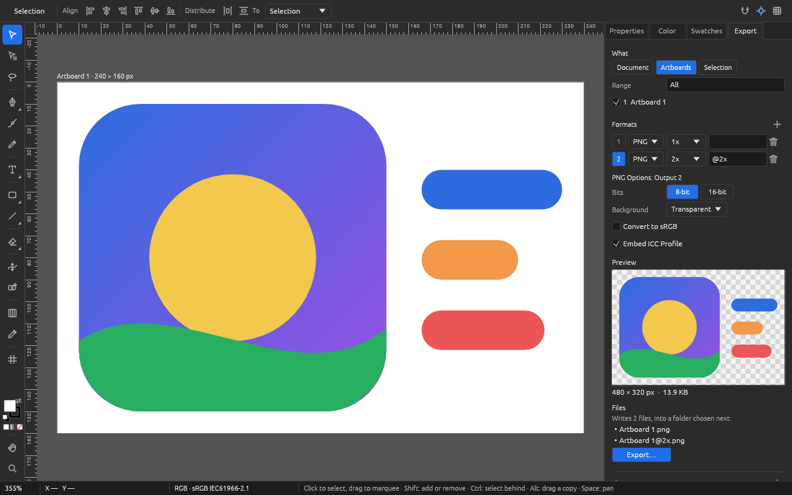

# Pixolotl

### Vector and raster design in one application

Drawing, type, colour for print, and pixels in the same document, so you do not need one program for
vectors and another for images. Free, with **no account, no telemetry and no AI**. 
Made by [CodeMushroom](https://github.com/CodeMushroom).

### [⬇ Download Pixolotl](https://github.com/CodeMushroom/Pixolotl/releases/latest)

> **This is an early test build.** Much of Pixolotl works today and some of it is not built yet (see
> [What is coming](#what-is-coming)). Keep copies of anything important, and please
> [report](#feedback) what goes wrong.

## What it does today

### Draw with precision

Shapes that stay editable, the Pen, Pencil, Paintbrush and Width tools, Shape Builder, Pathfinder and live
boolean shapes, Offset Path, Outline Stroke and Simplify. Several artboards, rulers, guides, grids, smart
guides and snapping. Every field takes typed numbers, units and arithmetic, and nothing drifts when you
save and open again.

### Colour for screen and print

RGB, CMYK, grayscale, Lab and spot colours with ICC colour management. CMYK documents with a press profile
included, soft proofing, gamut warning and overprint preview; their pixel layers are kept and painted in
ink. Swatches, linear, radial and conic gradients edited on the canvas, patterns, blend modes, and opacity
and clipping masks.

### Type

Point type, area type in any shape and type on a path, with character and paragraph controls, tabs,
OpenType features, variable fonts and styles. Arabic, Hebrew, Devanagari, Thai, Chinese, Japanese and
Korean are shaped and laid out properly, and colour fonts work.

### Pixels in the same document

Pixel layers sit next to vector layers. Select with marquees (free, fixed ratio or fixed size), lassos, the
Magnetic Lasso, the magic wand or colour range, refine with feather, grow, shrink, border, smooth and quick
mask, and paint on layers and masks with the Brush, Eraser, Smudge, Clone Stamp, Paint Bucket and Gradient.
The Brushes panel has pressure and tilt dynamics, colour jitter, wet edges, tapered strokes and a
stabilizer. Image Size and Canvas Size, layer locks, channels you can show, hide and protect, and copy and
paste of pixels with other programs.

### Adjust, retouch and style

Adjustment layers (Levels, Curves, Hue/Saturation, Posterize, Photo Filter, Colour Lookup with .cube
tables and eleven more) with masks, and adjustments, blurs, sharpening and noise on any layer, shape, text
or group; all stay editable. Layer Style with drop and inner shadows, glows, satin, colour, gradient and
pattern overlays, bevel and emboss, and strokes filled with a colour, gradient or pattern, with contours,
Global Light and a separate Fill opacity, blended with the layers below as Photoshop does. The Spot Healing
Brush, Healing Brush and
Patch tool, Dodge, Burn and Sponge, Free Transform with distort, perspective and warp, Refine Edge for
hair and soft edges, and Fill From Surroundings. Image Trace turns a picture into paths.

### Open and export the files you use

Opens SVG, PDF, Illustrator files saved with PDF content, Photoshop (PSD, PSB) and GIMP (XCF) files with
their layers, masks, adjustment layers and layer styles, PNG, JPEG, TIFF, WebP, ASE, ACO and GPL swatches,
and Photoshop and GIMP brushes. Exports SVG, PDF for print (CMYK, spot colours, bleed, crop marks and a
preflight check), PSD, PNG, JPEG, TIFF and WebP with a live preview and the exact file size. Every import tells you anything it could
not bring in. `pixolotl --export` converts files from the command line.

### Never lose work

Unlimited undo with a History panel, safe saving, and automatic recovery of unsaved work after a crash.
Panels dock, float, and fold into a column of icons, and their layout saves as named workspaces.
Dark and light themes, and interface text from 100% to 200%.

## What is coming

- More of Photoshop: smart objects, a vector mask and a pixel mask on one layer, noise and diamond gradients
- Live effects, symbols, and EPS and DXF export
- Preferences, a shortcut editor and a command palette
- **macOS and Linux** versions

The [changelog](CHANGELOG.md) lists what each version brings.

## Install

Open the **[latest release](https://github.com/CodeMushroom/Pixolotl/releases/latest)** and download the file
that ends in **`Windows-setup.exe`**. It installs for your Windows account only and needs no administrator
rights. Everything else attached to a release (`.sig`, `latest.json`) is for the built-in updater and can
be ignored.

The installer is not yet signed with a Windows certificate, so the first launch shows a warning. Choose
**More info → Run anyway**.

Uninstall from **Settings → Apps**. Your documents, brushes and fonts stay where they are.

## Updates

Pixolotl checks for a new version when it starts, and whenever you choose **Help → Check for Updates**.
When there is one, it tells you what is new and offers **Install and Restart**. Nothing is downloaded or
installed until you say so.

- **The update check is the only network request Pixolotl makes on its own.** It reads one public file
  from this repository's latest release. Nothing about you, your computer or your documents is sent.
  The only other request is a feedback report, and only when you send one (see [Privacy](#privacy)).
- **Every update is signed** by CodeMushroom and checked against a key built into Pixolotl before it is
  installed. A download that does not match is deleted.
- To stop the check at start, untick **Check for updates when Pixolotl starts** in **Help → About
  Pixolotl**.

## Feedback

Found a bug or want a feature? Choose **Help → Send Feedback…** in Pixolotl: write what happened, choose
what to include, and save the report (in this version it is saved as a file for you to attach; sending
from the application comes later). Or [open an issue](https://github.com/CodeMushroom/Pixolotl/issues/new/choose),
and say which version you have (Help → About Pixolotl) and what you did. If Pixolotl is useful to you,
a ⭐ on this repository helps other designers find it.

This repository holds Pixolotl's releases, release notes and issues.

## Privacy

Pixolotl has no account, no telemetry and no crash uploading. It sends nothing about you, your computer
or your work unless you send a feedback report yourself.

**Help → Send Feedback…** opens a window where you write a comment and tick what goes with it. Before
anything leaves your computer, **View Report Details** shows exactly what will be sent. Nothing is sent
until you press **Send**, and you can save the report as a file instead.

- **Your comment**, and a name or email only if you type one.
- **A screenshot of Pixolotl's window** (ticked; untick or remove it). Only Pixolotl's own window as it
  was when you chose Send Feedback: never your desktop or other programs. You can mark spots on it.
- **System and application details** (ticked): Pixolotl's version; your operating system's version,
  processor, memory, displays and their scaling; graphics cards and drivers; how smoothly Pixolotl
  was drawing; which pointing devices you used (mouse, touchpad, pen) and how their events arrived;
  recent warnings and errors.
- **Recent actions and tool state** (ticked): the last 60 tools, commands and clicks by name, the tool's
  settings, and an outline of your document: how many objects of each kind and their sizes. No text,
  no layer or file names, no paths.
- **Your document** (not ticked): only if you tick it, so a problem can be reproduced. It contains your
  artwork, its text and its names.

Each report carries a random install ID, so several reports from you can be read together; it is made
from nothing on your computer, and **Reset** in the window replaces it. Reports go over an encrypted
connection to a server run by CodeMushroom and are stored privately for CodeMushroom to read; they are
deleted after six months. The record of recent actions is kept only in memory while Pixolotl runs and
is never written to disk.

---

Pixolotl is made by **[CodeMushroom](https://github.com/CodeMushroom)**. Copyright © 2026 CodeMushroom.

Licensed under the [Apache License 2.0](LICENSE). Redistributions must keep the [NOTICE](NOTICE) crediting CodeMushroom. 
The Pixolotl name and axolotl logo are CodeMushroom trademarks: see [TRADEMARKS.md](TRADEMARKS.md).

